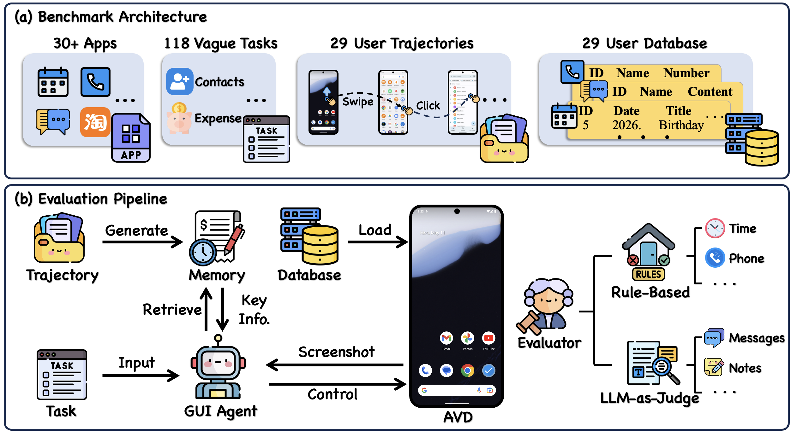
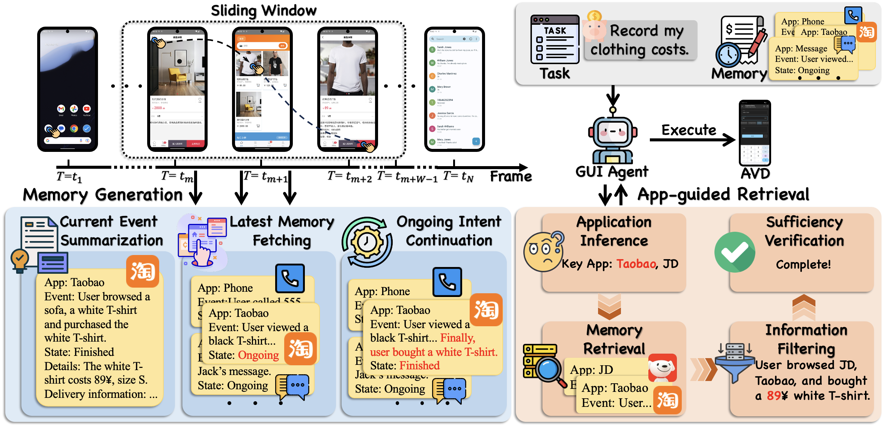

# MemU-Bench: Benchmarking GUI Agents on Long-Horizon User Interactions

MemU-Bench is a benchmark for evaluating how well autonomous GUI agents can leverage user history (memory) to complete ambiguous tasks on Android devices. MemU-Bench introduces a **memory suite** where task instructions contain ambiguous references that can only be resolved by recalling the user's past interactions.

## Key Features

- 🧠 **Memory-driven tasks**: Tasks are intentionally ambiguous — agents must retrieve relevant information from user history to succeed
- 📱 **User interaction trajectories**: Includes real user operation logs (screenshots + actions) as history context, with 118 tasks divided into **short** (71 tasks, ≤400 steps) and **long** (47 tasks, ≥700 steps) based on history length
- 📊 **Triple evaluation metrics**: **SR** (Success Rate), **SPL** (Success weighted by Path Length), and **IE** (Interaction Efficiency)

## Overview

### MemU-Bench Overview



### AppMem Overview



## Metrics

| Metric | Description |
|--------|-------------|
| **SR** | Success Rate |
| **SPL** | Success weighted by Path Length — penalizes inefficient solutions |
| **IE** | Interaction Efficiency — measures how efficiently the agent interacts with the environment |

## Project Layout

```
├── batch_restore_and_snapshot.py   # Emulator initialization & snapshot creation
├── move_data/                       # Data restoration scripts for emulator setup
├── run_memubench.py                  # Main evaluation runner
├── apks/                            # App APK files for emulator setup
├── user_database/                  # Per-user app data for emulator initialization
├── user_history/                   # User operation logs (screenshots + processed.jsonl)
├── memory_generation/
│   ├── generate_tasks_map.py       # Generate user → task goal mapping
│   ├── tasks_map.json              # Pre-generated task mapping
│   └── memory/
│       └── generate_memory.py      # Generate memory from operation logs (AppMem)
├── retrieve_information/
│   └── retrieve_information.py     # Retrieve relevant info for each task
├── eval/
│   ├── eval_checkpoint.py          # Extract checkpoint results to JSON
│   └── eval_metrics.py             # Calculate SR, SPL, IE from two JSON files
├── eval_results/
│   └── human.json                  # Pre-generated human reference results
├── android_world/                  # Core environment (based on AndroidWorld)
│   ├── agents/                     # Agent implementations
│   ├── task_evals/fixed_tasks/     # Task definitions per user/history-length
│   └── env/                        # Android environment & ADB utilities
```

## Installation

1. Set up the Android Emulator

   Download [Android Studio](https://developer.android.com/studio) and create an Android Virtual Device (AVD): select **Pixel 6**, System Image **Tiramisu, API Level 33**, and AVD name **MemUBenchAvd**. Emulator setup instructions can also be found in [AndroidWorld](https://github.com/google-research/android_world).

2. Create a conda environment

   ```bash
   conda create -n memu_bench python=3.11
   conda activate memu_bench
   ```

3. Install dependencies

   ```bash
   pip install -r requirements.txt
   python setup.py install
   ```

4. Install `ffmpeg` (if not already installed)

   ```bash
   # macOS
   brew install ffmpeg
   ```

## Quick Start (AppMem)

The full evaluation pipeline consists of the following steps:

### Step 1: Download the Dataset

Download the dataset from [https://huggingface.co/datasets/vagrt/MemU-Bench-data](https://huggingface.co/datasets/vagrt/MemU-Bench-data) and place it in the project root:
- `apks/` — app APK files for emulator setup
- `user_database/` — contains app data for each user, used for emulator initialization. The dataset is distributed as `user_*.tar.zst` archives; extract them in the project root before running the pipeline:
  ```bash
  mkdir -p user_database
  for archive in user_database/*.tar.zst; do
    zstd -dc "$archive" | tar -xf - -C user_database
  done
  ```
  Install `zstd` first if it is unavailable (for example, `brew install zstd` on macOS).
  After extraction, the directory should contain `user_database/user_0/` through `user_database/user_11/`.
- `user_history/` — contains user operation logs (screenshots + `processed.jsonl`), used for memory generation and retrieval

### Step 2: Create the Android Emulator

Launch the emulator from the command line with the gRPC flag:

```bash
EMULATOR_NAME=MemUBenchAvd
~/Library/Android/sdk/emulator/emulator -avd $EMULATOR_NAME -no-snapshot -grpc 8554
```

### Step 3: Initialize the Emulator (One-time Setup)

Run the batch restore script to install apps, restore user data, and create snapshots. **This step only needs to be done once** — the snapshots are reusable across multiple evaluation runs.

```bash
python batch_restore_and_snapshot.py --install-apps --apk-dir ./apks
```

After this, the emulator will have snapshots like `snapshot_0_short`, `snapshot_0_long`, etc. Subsequent evaluations can load these snapshots directly without re-initializing.

### Step 4: Configure Model & API Credentials

Create a `.env` file in the project root specifying the model and API credentials:

```bash
MODEL=your_model_name
API_KEY=your-api-key
BASE_URL=your-base-url
```

This configures the model used across the entire pipeline — memory generation, retrieval, and online execution will all use this model.

Additionally, update `fixed.env` with the judger and grounding model configurations. Expected models:
- `JUDGER_MODEL`: Qwen3.5-35B-A3B
- `GROUNDING_MODEL`: Qwen3-VL-32B-Instruct

```bash
JUDGER_API_KEY=your-judger-api-key
JUDGER_BASE_URL=your-judger-base-url
JUDGER_MODEL=Qwen3.5-35B-A3B

VLM_JUDGER_API_KEY=your-judger-api-key
VLM_JUDGER_BASE_URL=your-judger-base-url
VLM_JUDGER_MODEL=Qwen3.5-35B-A3B

GROUNDING_API_KEY=your-grounding-api-key
GROUNDING_BASE_URL=your-grounding-base-url
GROUNDING_MODEL=Qwen3-VL-32B-Instruct
```

### Step 5: Memory Generation

This step generates structured memory from raw user operation logs, then retrieves relevant information for each task.

Generate task mapping (if `memory_generation/tasks_map.json` does not exist, run this to generate it):

```bash
python memory_generation/generate_tasks_map.py
```

Generate memory from user operation logs:

```bash
python memory_generation/memory/generate_memory.py \
    --session_paths ./user_history \
    --output_path ./user_information/memory/${MODEL_NAME}.json \
    --env_file .env
```

### Step 6: App-guided Retrieval

Retrieve relevant information from memory for each task:

```bash
python retrieve_information/retrieve_information.py \
    --method memory \
    --path ./user_information/memory/${MODEL_NAME}.json \
    --output ./relevant_information/memory/${MODEL_NAME}.json \
    --log_path ./retrieve_log/memory/${MODEL_NAME}.txt \
    --env_file .env
```

### Step 7: Run Evaluation on the Emulator

Run the agent on the memory suite tasks, using the retrieved information:

```bash
python run_memubench.py \
    --suite_family memory_suite \
    --checkpoint_dir ./checkpoint_results/${MODEL_NAME}/memory/run1 \
    --method with_history \
    --user_information_path ./relevant_information/memory/${MODEL_NAME}.json \
    --eval_setting unclear_goal \
    --env_file .env
```

### Step 8: Calculate Metrics & Save Results

First, extract checkpoint results into a JSON file:

```bash
python eval/eval_checkpoint.py \
    --checkpoint_dir ./checkpoint_results/${MODEL_NAME}/memory/run1 \
    --output ./eval_results/${MODEL_NAME}_memory.json
```

Then, calculate SR, SPL, IE by comparing with the provided human reference:

```bash
python eval/eval_metrics.py \
    --ref ./eval_results/human.json \
    --eval ./eval_results/${MODEL_NAME}_memory.json \
    --output ./metric_results/memory.json
```

## Custom Methods

MemU-Bench is designed to be modular — you can plug in your own memory processing and retrieval methods while reusing the rest of the benchmark pipeline.

### Memory Generation

You can replace `memory_generation/memory/generate_memory.py` with your own script to process user operation logs. The output format is flexible and can be whatever structure your method requires.

### Retrieval

To use your own retrieval method, implement a retrieval module in `retrieve_information/` (e.g., `retrieve_information/your_method.py`) with a `get_filtered_history(goal, path, ...)` function, then register it in `retrieve_information/__init__.py` by adding a new `elif` branch for your method name. When running retrieval, specify your method name via `--method`:

```bash
python retrieve_information/retrieve_information.py \
    --method your_own_method \
    --path /path/to/your/generated/data \
    --output ./relevant_information/your_own_method/${MODEL_NAME}.json \
    --env_file .env
```

Then in online evaluation, simply use `--method with_history` and point `--user_information_path` to your retrieval output:

```bash
python run_memubench.py \
    --suite_family memory_suite \
    --method with_history \
    --user_information_path ./relevant_information/your_own_method/${MODEL_NAME}.json \
    --eval_setting unclear_goal \
    --env_file .env
```

The only requirement is that the output JSON follows this format, since downstream task execution reads the retrieved information from it:

```json
{
  "results": [
    {
      "goal": "the ambiguous task instruction",
      "subdir": "short",
      "user_history": "the retrieved information for this task"
    }
  ]
}
```

As long as the retrieval output format is consistent, the downstream steps (online evaluation, metric calculation) remain unchanged.

## Acknowledgements

This codebase is built upon [AndroidWorld](https://github.com/google-research/android_world). For emulator configuration details, see the AndroidWorld documentation.
